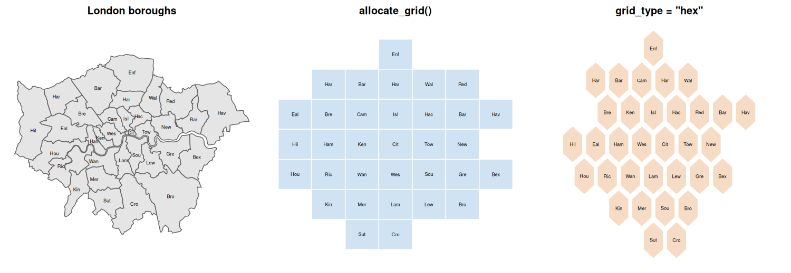

# gridmapper

<!-- badges: start -->
<!-- badges: end -->

gridmapper allocates geographic features to the cells of a rectangular or
hexagonal grid, producing grid cartograms that keep features close to their
geographic position. Each feature is assigned to one cell by solving a mixed
integer programme with [HiGHS](https://highs.dev), and a compactness
parameter controls how tightly the layout clusters.

It is an R port of the [gridmapper](https://github.com/danylaksono/gridmapper)
JavaScript library, which builds on Jo Wood's
[grid map allocation](https://observablehq.com/@jwolondon/gridmap-allocation).



## Installation

The package lives in the `rpkg/` directory of the gridmapper repository.
From a clone of the repository:

``` r
# install.packages("devtools")
devtools::install("rpkg")
```

## Example

Allocate points from a data frame:

``` r
library(gridmapper)

gm <- allocate_grid(us_states, x = "lon", y = "lat", compactness = 0.6)
gm
#> <gridmap> 50 features on a 5 x 10 rect grid
#> Score: 308.795 (Optimal)

head(as.data.frame(gm))
plot(gm, labels = "abbr")
```

Polygons in an sf object are represented by their interior label point
(`polygon_centroid()`). `estimate_parameters()` suggests grid dimensions,
compactness and rotation from the shapes of the features:

``` r
london <- sf::st_read(
  system.file("extdata", "london.geojson", package = "gridmapper"),
  quiet = TRUE
)
params <- estimate_parameters(london)

gm <- allocate_grid(
  london,
  rows = params$rows,
  cols = params$cols,
  compactness = params$compactness,
  rotate_pca = params$rotate_pca,
  grid_type = "hex"
)

# Tiles as sf polygons, carrying the attributes of `london`
tiles <- grid_to_sf(gm)
```

Further options of `allocate_grid()`:

* `spacers` or `mask`: keep cells empty, either hard (excluded) or soft
  (penalised, `spacer_mode = "soft"`).
* `adjacency_weight`: reward neighbouring occupied cells for more contiguous
  layouts.
* `adjacency_graph` with `pairwise_adjacency_options()`: reward neighbouring
  features placed in neighbouring cells.
* `embedding_targets`: pull features towards a graph layout from
  `estimate_parameters(embedding = TRUE)`.
* `post_process_options()`: greedy swaps, simulated annealing and an
  adjacency fixer applied after solving.

Dorling and Demers cartograms size symbols by a weight:

``` r
london$area <- as.numeric(sf::st_area(sf::st_transform(london, 27700)))
dorling <- dorling_cartogram(london, "area", k = 3, seed = 1)
demers <- demers_cartogram(london, "area", k = 3, seed = 1)
```

## Differences from the JavaScript library

The port reproduces the JavaScript results: the test suite compares
estimated parameters, objective values, adjacency graphs and seeded Dorling
and Demers layouts against outputs of the JavaScript library. The
differences are:

* **R conventions.** Rows and columns are numbered from 1 (row 1 is at the
  bottom). Function and argument names use snake_case, e.g. `allocate()`
  became `allocate_grid()`, `rotateByPCA` became `rotate_pca`, and `runSA`
  became `post_process_options(anneal = TRUE)`. Results are `gridmap` objects
  and sf data frames instead of plain objects and GeoJSON.
* **Solver.** HiGHS replaces glpk.js, and there is no pluggable solver
  argument. When a problem has several optimal solutions, the solvers may
  pick different ones with the same objective value.
* **Objective terms are summed.** glpk.js keeps only the last coefficient of
  a variable that appears more than once in the objective, so in the
  JavaScript library the embedding and soft-spacer penalties *replace* the
  distance cost. Here they are added to it.
* **`allocate_grid_simple()`** compares x with columns and y with rows. The
  JavaScript `allocateSimple()` compares x with rows, which is only correct
  for square grids.
* **Masks** are rotated together with the data when `rotate_pca = TRUE`.
* **Embedding targets** are given in the coordinate space of the input data
  and normalised the same way as the data.
* **Post-processing** uses hexagonal cell centres on hex grids and counts
  both diagonals when `adjacency_diagonal = TRUE`. The adjacency fixer's
  swap step only swaps when that reduces the number of cut edges, and
  reports the initial cut count.
* **`embed_graph()`** uses a spring length based on the unit layout area
  rather than on `width * height`.
* `createPointsGeoJson()` and `projectGeoJson()` are not ported; use
  `sf::st_as_sf()` and `sf::st_transform()`.
